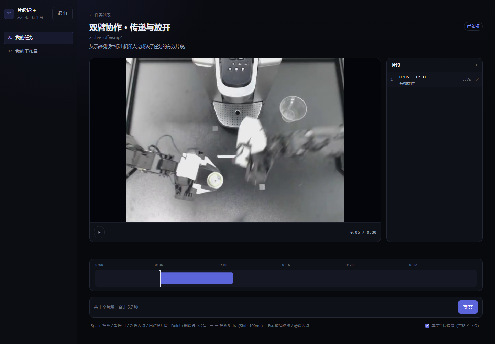
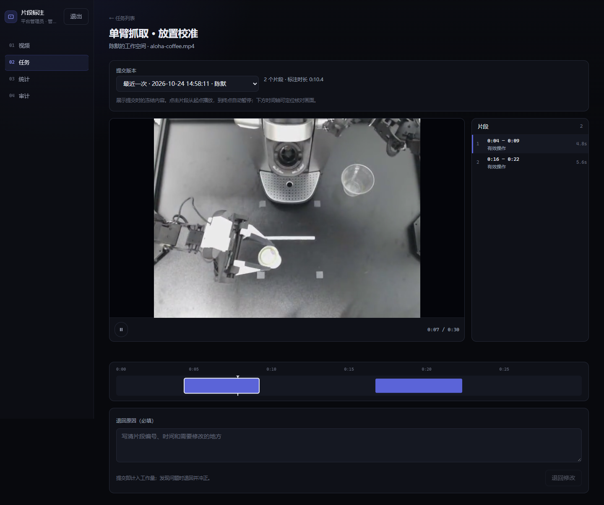
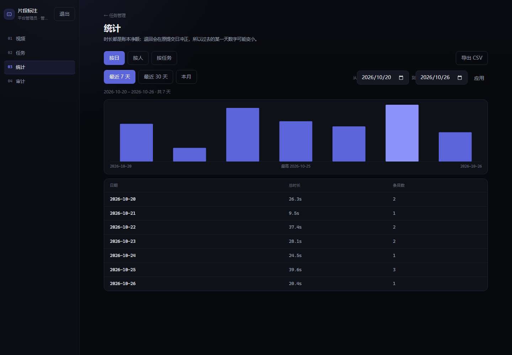

# 视频片段标注平台

让标注员从机器人示教视频中标出有效时间段，由管理员按提交日期统计工作量，替代手工填表和汇总。

**个人仓库**：[Li-Liu-hub/video-clip-annotator](https://github.com/Li-Liu-hub/video-clip-annotator)

## 已实现

| 角色 | 功能 |
|---|---|
| 管理员 | 上传视频、指定租户发布任务、查看已有任务、播放提交片段、退回修改、查看统计和导出 CSV |
| 标注员 | 登录、领取本租户任务、在时间轴标注片段、撤销和调整、提交、查看本人工作量 |

- 同一任务内片段不能重叠，后端校验并由数据库触发器兜底。
- 只有提交后的片段计入工作量，按提交日归集；退回时冲正原提交日的工作量。
- 租户隔离在后端完成，管理员审核读取提交时的冻结快照。
- 标注与审核共用播放器和片段列表，支持时间轴定位；审核片段播放到终点自动暂停。

当前演示采用“一位标注员一个租户/工作空间”，尚未提供多人团队成员管理。

## 界面截图

以下截图使用演示数据，点击图片可查看大图。

**标注工作台**：视频播放、片段列表、时间轴、提交与快捷键。



**管理员审核**：查看提交快照，按片段播放并填写退回原因。



**工作量统计**：按提交日期查看有效时长，支持筛选与 CSV 导出。



## 技术栈

Next.js 15、React 19、TypeScript、Tailwind CSS 4、SQLite / better-sqlite3。视频通过带鉴权的 HTTP Range 接口播放，不依赖外部数据库服务。

## 启动

建议 Node.js 22 LTS。首次安装依赖需要联网；原生模块没有匹配预编译包时可能需要本机编译工具。

```bash
git clone https://github.com/Li-Liu-hub/video-clip-annotator.git
cd video-clip-annotator
npm ci
npm run dev
```

打开 [本地登录页](http://localhost:3000/login)。首次启动自动创建数据库和示例任务，终端输出一次初始随机口令。用户名为 `admin`、`alice`、`bob`、`carol`，默认共用这次生成的口令。已有数据库会保留原数据和密码。

<details>
<summary>固定演示账号（PowerShell）</summary>

以下重建操作会删除当前数据库和视频目录，仅用于可丢弃的演示数据：

```powershell
$env:DEMO_LOGIN = "1"
node scripts/setup.mjs --reset
$env:NEXT_PUBLIC_DEMO_LOGIN = "1"
npm run dev
```

管理员 `admin / admin123`；标注员 `alice`、`bob`、`carol` 的密码均为 `demo123`。

</details>

生产运行：先 `npm run build`，再 `npm start`。数据保存在 `data/app.db` 和 `data/videos/`，部署配置见 [docs/DEPLOY.md](docs/DEPLOY.md)。

## 项目结构

```text
src/app/            页面与 API：登录、任务、标注、审核、统计、审计
src/components/     共用导航、页面外壳和播放器
src/lib/server/     请求身份和访问守卫
src/lib/services/   业务规则与事务
src/lib/db/         表结构、约束和 SQL 查询
scripts/            初始化、规范扫描、数据检查、浏览器验收
tests/              单元、服务与组件测试
fixtures/videos/    示例视频
docs/steps/         拆分后的开发文档与验收清单
RULES.md            开发规范
report.md           开发流程、设计取舍、AI 验证与已知限制
```

## 开发与验证

我先用 **GPT6.1SOL** 将需求拆成开发文档，再使用 **DeepSeek V4.1 Flash 1024** 按文档逐步开发，流程遵循 [RULES.md](RULES.md)。具体说明见 [report.md](report.md)。项目运行时不调用大模型。

```bash
npm test                       # 规范扫描、SQL 扫描、ESLint、单元与组件测试
npx tsc --noEmit                # 类型检查
npm run build                  # 生产构建
npm run verify                 # 单测 + 浏览器验收，需先完成构建
```

浏览器验收需先安装：`python -m pip install playwright`、`python -m playwright install chromium`。最近记录为 **908 项自动化测试、99 项浏览器检查通过**，验证环境与剩余问题见报告。

题目提供的素材来源：[ALOHA 双臂做咖啡](https://huggingface.co/datasets/lerobot/aloha_static_coffee)、[Push-T 推方块](https://huggingface.co/datasets/lerobot/pusht)。仓库已附示例视频，首次运行无需另行下载。
