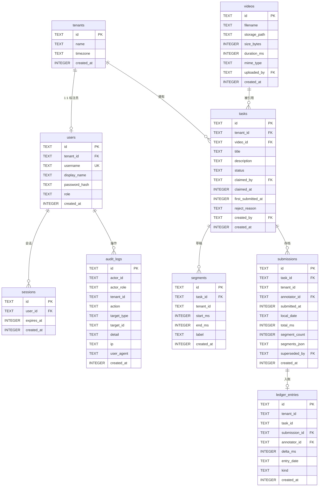

# 视频片段标注平台 · 设计文档

> 本文档是唯一入口，包含业务模型、系统架构、**数据库设计**、关键流程与保障措施。  
> 合并了此前的 `ARCHITECTURE.md` 与 `DEVELOPMENT.md`，避免多份文档不同步。

---

## 目录

- [1. 业务模型](#1-业务模型)
- [2. 系统架构](#2-系统架构)
- [3. 数据库设计](#3-数据库设计)
- [4. 关键流程](#4-关键流程)
- [5. 正确性保障](#5-正确性保障)
- [6. 待确认事项](#6-待确认事项)

---

## 1. 业务模型

### 1.1 要解决的问题

数据团队需要标注员从机器人示教视频里标出有用的时间段。

现状：标注员把起止时间填进表格 → 管理员每天手工汇总 → **数字经常对不上**。

这句话是全文最重要的需求信号。它意味着：

- 用户要的不只是「能录入」，而是「录进去的数不会再变」
- 出错的根因是「同一份数据被反复重算」，不是「人不细心」
- 因此统计必须是**可追溯的记账**，不能是对当前状态的实时聚合

### 1.2 租户模型

**一个标注员 = 一个租户。**

README 写「每个标注员属于一个租户，只能看到本租户的任务」。在「管理员发布任务时指定租户」  
的前提下，唯一自洽的解释是：租户是标注员的**个人工作空间**，与标注员 1:1。  
管理员「指定租户」这个动作，实际就是「选择分配给谁」。

| 主体  | tenant_id | 可见范围   |
| --- | --------- | ------ |
| 管理员 | `NULL`    | 全部租户   |
| 标注员 | 非空，全表唯一   | 仅自己的租户 |

「一个租户只有一个人」由**部分唯一索引**保证，不靠应用层自觉。  
若将来要支持「一个租户多个标注员」，删掉该索引即可，其余代码不动。

### 1.3 角色与权限

| 能力        | 管理员     | 标注员     |
| --------- | ------- | ------- |
| 上传视频      | ✓       | ✗       |
| 创建任务并指定租户 | ✓       | ✗       |
| 查看任务列表    | 全部租户    | 仅自己     |
| 领取任务      | ✗       | 自己租户的池子 |
| 标注 / 编辑片段 | ✗       | 仅已领取的任务 |
| 提交        | ✗       | 仅已领取的任务 |
| 退回提交      | ✓       | ✗       |
| 按天统计      | 全部 / 按人 | 仅本人     |
| 导出        | ✓       | 仅本人     |
| 查看审计日志    | ✓       | ✗       |

### 1.4 两个动作是分开的

- **管理员「分配」**：创建任务时选定租户，任务进入该租户的 `pending` 池
- **标注员「领取」**：从池中领取，任务变 `claimed`，此时才能编辑

这样「管理员分配」与「标注员领取」同时成立。`claim` 是一个有审计价值的时间点——  
它记录「谁在什么时候开始做」，而不只是「任务创建于何时」。

### 1.5 明确不做的事

- 注册、找回密码（账号由 seed 提供）
- 「同一任务多人协作」（任务属于租户、每租户一人，逻辑上不成立）
- 多级质检审核（只有单次退回）
- 通知、邮件、站内信
- 移动端专门适配
- 水平扩展

---

## 2. 系统架构

### 2.1 分层与依赖规则

```
┌──────────────────────────────────────────────────┐
│  app/          路由层                             │
│  Server Components  ──┐                          │
│  Route Handlers      ─┼──► services              │
└───────────────────────┼──────────────────────────┘
                        │  禁止直接访问 db（ESLint）
┌───────────────────────▼──────────────────────────┐
│  lib/services/      业务逻辑                       │
│  签名 (db, actor, ...)，不 import next/headers    │
└───────────────────────┬──────────────────────────┘
                        │  唯一允许写 SQL 的层
┌───────────────────────▼──────────────────────────┐
│  lib/db/repos/      数据访问                       │
└───────────────────────┬──────────────────────────┘
                        ▼
┌──────────────────────────────────────────────────┐
│  SQLite   WAL + 外键 + 触发器                      │
└──────────────────────────────────────────────────┘
```

**三条硬规则**

1. `app/**` 不得 import `lib/db/**`（ESLint `no-restricted-imports` 强制）
2. `lib/services/**` 不得 import `next/headers`（保证可用内存库单测）
3. 只有 `lib/db/repos/**` 可以出现 SQL 字符串（`scripts/audit-sql.mjs` 扫描）

**service 签名为什么带 `db`**：全局单例无法让测试用例相互隔离；显式注入后每个用例可拿全新的  
`:memory:` 库。这是 TDD 倒逼的架构决策。

### 2.2 技术选型

| 层    | 选择                             | 关键理由                          |
| ---- | ------------------------------ | ----------------------------- |
| 运行时  | Node ≥ 20.9                    | Next 15 要求                    |
| 框架   | Next.js 15 App Router          | 单进程单端口；隔离天然在后端                |
| 语言   | TypeScript strict              | —                             |
| 数据库  | SQLite + better-sqlite3 13     | 零外部依赖；预编译二进制随包分发，实测 6 秒装完、零编译 |
| 数据访问 | 手写 SQL + repository            | 租户谓词肉眼可审、脚本可扫；API 稳定不被 AI 写错  |
| 样式   | Tailwind v4                    | 标注器需精细控制                      |
| 认证   | 自建 session 表 + httpOnly cookie | 40 行，可控                       |
| 密码   | `node:crypto` scrypt           | 零依赖                           |
| 时间   | `Intl.DateTimeFormat`          | 零依赖，时区换算可靠                    |
| 视频流  | Route Handler + 自实现 Range      | **不能放 public，否则绕过权限**         |
| 测试   | Vitest                         | TS 原生支持                       |

### 2.3 已知取舍

| 取舍                 | 代价                        | 是否可推翻             |
| ------------------ | ------------------------- | ----------------- |
| SQLite 而非 Postgres | 无 RLS、无 `EXCLUDE` 约束、不能多机 | 可，schema 不依赖方言    |
| 手写 SQL 而非 ORM      | 罗嗦                        | 可，repository 是隔离带 |
| 不用组件库              | 组件自写                      | 可，随时引入            |
| 视频时长信任前端上报         | 不解析容器                     | 可，加 ffprobe       |

---

## 3. 数据库设计

### 3.1 全貌



### 3.2 表清单

| # | 表                | 职责              | 记录量级   | 可变性      |
| - | ---------------- | --------------- | ------ | -------- |
| 1 | `tenants`        | 标注员的个人工作空间      | 与标注员同量 | 可改       |
| 2 | `users`          | 账号与角色           | 少      | 可改       |
| 3 | `videos`         | 视频资产            | 少      | 可删除      |
| 4 | `tasks`          | 任务与状态           | 中      | 状态可变     |
| 5 | `segments`       | **工作区**：正在编辑的片段 | 中      | 频繁增删改    |
| 6 | `submissions`    | **存档**：提交时的冻结快照 | 中      | **永不修改** |
| 7 | `ledger_entries` | **记账**：统计的唯一数据源 | 中      | **只追加**  |
| 8 | `audit_logs`     | **留痕**：操作审计     | 多      | **只追加**  |
| 9 | `sessions`       | 登录会话            | 少      | 可删除      |

**四张表的关系是本设计的核心**

```
segments     ── 标注员正在改的东西，随时变
submissions  ── 提交那一刻的冻结副本，之后永不修改
ledger_entries ── 统计只读这张表，一次 SUM 出结果
audit_logs   ── 追责用，不参与任何业务计算
```

没有「工作区 vs 存档」的区分，用户改一次草稿历史就变了——这正是题目抱怨的问题。  
没有「账本 vs 审计」的区分，统计查询会被无关事件污染，或者出问题查不到人。


### 3.3 逐表定义

#### 3.3.1 `tenants` — 租户

```sql
CREATE TABLE tenants (
  id          TEXT PRIMARY KEY,
  name        TEXT NOT NULL,
  timezone    TEXT NOT NULL DEFAULT 'Asia/Shanghai',
  created_at  INTEGER NOT NULL
);
```

| 字段           | 类型      | 约束       | 说明                   |
| ------------ | ------- | -------- | -------------------- |
| `id`         | TEXT    | PK       | 16 位十六进制             |
| `name`       | TEXT    | NOT NULL | 展示名，如「林小雨的工作空间」      |
| `timezone`   | TEXT    | NOT NULL | IANA 时区，决定「哪一天」的切分口径 |
| `created_at` | INTEGER | NOT NULL | UTC 毫秒               |

**设计要点**

- 为什么时区放在租户上而不是全局配置：不同地区的标注员可能在不同时区，  
  「今天标了多少」应该按他自己的日历算。当前种子数据都是 `Asia/Shanghai`。
- 为什么不用 `tenant_id` 直接引用 `users.id`：保留一层间接，将来「一个租户多人」不用改外键。

#### 3.3.2 `users` — 用户

```sql
CREATE TABLE users (
  id            TEXT PRIMARY KEY,
  tenant_id     TEXT REFERENCES tenants(id),
  username      TEXT NOT NULL UNIQUE,
  display_name  TEXT NOT NULL,
  password_hash TEXT NOT NULL,
  role          TEXT NOT NULL CHECK (role IN ('admin', 'annotator')),
  created_at    INTEGER NOT NULL,
  CHECK ((role = 'admin'     AND tenant_id IS NULL) OR
         (role = 'annotator' AND tenant_id IS NOT NULL))
);

CREATE UNIQUE INDEX idx_one_annotator_per_tenant
  ON users(tenant_id) WHERE role = 'annotator';
```

| 字段              | 类型      | 约束                    | 说明                             |
| --------------- | ------- | --------------------- | ------------------------------ |
| `id`            | TEXT    | PK                    | —                              |
| `tenant_id`     | TEXT    | FK → tenants, NULL 允许 | 管理员为 NULL；标注员必填                |
| `username`      | TEXT    | UNIQUE, NOT NULL      | 登录名                            |
| `display_name`  | TEXT    | NOT NULL              | 显示名                            |
| `password_hash` | TEXT    | NOT NULL              | `scrypt$<salt hex>$<hash hex>` |
| `role`          | TEXT    | CHECK                 | `admin` / `annotator`          |
| `created_at`    | INTEGER | NOT NULL              | —                              |

**两条约束的意图**

1. **表级 CHECK**：把「管理员不属于任何租户、标注员必须属于一个租户」写死在数据库里。  
   这本来只是一句设计约定，写成 CHECK 之后，数据被手工改坏也会被拒绝。
2. **部分唯一索引**：保证一个租户只有一个标注员。`WHERE role = 'annotator'` 是关键——  
   否则多个管理员的 `tenant_id` 都是 NULL，会被 UNIQUE 判定冲突。

第二条是这个模型最容易被忽略的坑：**SQLite / Postgres 的 UNIQUE 对 NULL 的处理是「多个 NULL 不算重复」**，  
所以哪怕不加 `WHERE` 也不会误伤管理员，但加上更明确。

#### 3.3.3 `videos` — 视频资产

```sql
CREATE TABLE videos (
  id            TEXT PRIMARY KEY,
  filename      TEXT NOT NULL,
  storage_path  TEXT NOT NULL,
  size_bytes    INTEGER NOT NULL,
  duration_ms   INTEGER NOT NULL,
  mime_type     TEXT NOT NULL DEFAULT 'video/mp4',
  uploaded_by   TEXT NOT NULL REFERENCES users(id),
  created_at    INTEGER NOT NULL,
  CHECK (size_bytes > 0),
  CHECK (duration_ms > 0)
);
```

| 字段             | 类型      | 约束         | 说明                                 |
| -------------- | ------- | ---------- | ---------------------------------- |
| `id`           | TEXT    | PK         | —                                  |
| `filename`     | TEXT    | NOT NULL   | 原始文件名，仅展示用                         |
| `storage_path` | TEXT    | NOT NULL   | 相对 `data/videos/` 的路径，如 `a1b2.mp4` |
| `size_bytes`   | INTEGER | CHECK > 0  | 字节数                                |
| `duration_ms`  | INTEGER | CHECK > 0  | 时长，前端 `loadedmetadata` 上报          |
| `mime_type`    | TEXT    | NOT NULL   | 当前只允许 `video/mp4`                  |
| `uploaded_by`  | TEXT    | FK → users | 只有管理员能上传                           |
| `created_at`   | INTEGER | NOT NULL   | —                                  |

**为什么视频独立成表，而不是塞进 `tasks.video_path`**

1. **一视频多任务**：同一个素材分给三个标注员，建三个任务引用同一个 `video_id`。  
   若路径存在任务上，要存三份，删任务时还可能误删文件。
2. **视频有独立生命周期**：上传、校验、删除都不该混在任务状态机里。
3. **权限判断有据可依**：视频本身不绑定租户，访问时通过 `task → video` 判断当前用户是否有权看。

#### 3.3.4 `tasks` — 任务

```sql
CREATE TABLE tasks (
  id                 TEXT PRIMARY KEY,
  tenant_id          TEXT NOT NULL REFERENCES tenants(id),
  video_id           TEXT NOT NULL REFERENCES videos(id),
  title              TEXT NOT NULL,
  description        TEXT,
  status             TEXT NOT NULL DEFAULT 'pending'
                     CHECK (status IN ('pending', 'claimed', 'submitted', 'rejected')),
  claimed_by         TEXT REFERENCES users(id),
  claimed_at         INTEGER,
  first_submitted_at INTEGER,
  reject_reason      TEXT,
  created_by         TEXT NOT NULL REFERENCES users(id),
  created_at         INTEGER NOT NULL,
  CHECK ((status = 'pending' AND claimed_by IS NULL) OR
         (status <> 'pending' AND claimed_by IS NOT NULL))
);

CREATE INDEX idx_tasks_tenant ON tasks(tenant_id, status);
CREATE INDEX idx_tasks_status ON tasks(status, created_at);
```

| 字段                   | 类型      | 约束           | 说明                                               |
| -------------------- | ------- | ------------ | ------------------------------------------------ |
| `id`                 | TEXT    | PK           | —                                                |
| `tenant_id`          | TEXT    | FK → tenants | **分配目标**，决定谁能看到                                  |
| `video_id`           | TEXT    | FK → videos  | —                                                |
| `title`              | TEXT    | NOT NULL     | 任务名                                              |
| `description`        | TEXT    | 可空           | —                                                |
| `status`             | TEXT    | CHECK        | `pending` / `claimed` / `submitted` / `rejected` |
| `claimed_by`         | TEXT    | FK → users   | 领取人                                              |
| `claimed_at`         | INTEGER | 可空           | 领取时间，超时回收依据                                      |
| `first_submitted_at` | INTEGER | 可空           | 首次提交时间，**不可变**                                   |
| `reject_reason`      | TEXT    | 可空           | 最近一次退回原因，重新提交时清空                                 |
| `created_by`         | TEXT    | FK → users   | 创建者（管理员）                                         |
| `created_at`         | INTEGER | NOT NULL     | —                                                |

**状态与领取人的一致性 CHECK**

`pending` 时不得有 `claimed_by`，其余状态必须有。这条约束防的是「状态回退但领取人没清」的脏数据——  
超时回收时如果不把 `claimed_by` 置 NULL，写入会直接被拒绝，问题当场暴露而不是留到以后。

**`first_submitted_at` 与 `submissions.submitted_at` 的区别**

前者是任务维度的「第一次提交」，用于「任务从分配到完成用了多久」；后者是每次提交的独立时间戳。  
重新提交不会改 `first_submitted_at`。

**索引理由**

- `idx_tasks_tenant (tenant_id, status)`：标注员拉「我池子里待领取的」——最热的查询
- `idx_tasks_status (status, created_at)`：管理员拉「全平台待处理」

#### 3.3.5 `segments` — 工作区（草稿）

```sql
CREATE TABLE segments (
  id         TEXT PRIMARY KEY,
  task_id    TEXT NOT NULL REFERENCES tasks(id) ON DELETE CASCADE,
  tenant_id  TEXT NOT NULL,
  start_ms   INTEGER NOT NULL,
  end_ms     INTEGER NOT NULL,
  label      TEXT,
  created_at INTEGER NOT NULL,
  CHECK (end_ms > start_ms),
  CHECK (start_ms >= 0)
);

CREATE INDEX idx_segments_task ON segments(task_id, start_ms);
```

| 字段           | 类型      | 约束                            | 说明       |
| ------------ | ------- | ----------------------------- | -------- |
| `id`         | TEXT    | PK                            | —        |
| `task_id`    | TEXT    | FK → tasks, ON DELETE CASCADE | —        |
| `tenant_id`  | TEXT    | NOT NULL，**无外键**              | 防御性冗余，见下 |
| `start_ms`   | INTEGER | CHECK ≥ 0                     | 入点（毫秒）   |
| `end_ms`     | INTEGER | CHECK > start_ms              | 出点（毫秒）   |
| `label`      | TEXT    | 可空                            | 片段标签     |
| `created_at` | INTEGER | NOT NULL                      | —        |

**`tenant_id` 为什么冗余**

严格来说，租户可以通过 `task_id` join 出来，这个字段违反范式。保留它是因为：

- 即使某条查询忘了 join `tasks`，`WHERE tenant_id = ?` 依然生效
- 静态审计脚本可以只扫这一张表就判断谓词是否遗漏，不需要做数据流分析

代价是写入时要从任务带过来，且理论上可能不一致。用一条不变量检查兜底：  
`segments.tenant_id` 必须等于其 `task.tenant_id`。

**区间不重叠由触发器保证**，见 §3.4。

#### 3.3.6 `submissions` — 存档（不可变）

```sql
CREATE TABLE submissions (
  id            TEXT PRIMARY KEY,
  task_id       TEXT NOT NULL REFERENCES tasks(id),
  tenant_id     TEXT NOT NULL,
  annotator_id  TEXT NOT NULL REFERENCES users(id),
  submitted_at  INTEGER NOT NULL,
  local_date    TEXT NOT NULL,
  total_ms      INTEGER NOT NULL,
  segment_count INTEGER NOT NULL,
  segments_json TEXT NOT NULL,
  superseded_by TEXT REFERENCES submissions(id),
  created_at    INTEGER NOT NULL
);

CREATE INDEX idx_submissions_task ON submissions(task_id, created_at);
```

| 字段              | 类型      | 约束                  | 说明                       |
| --------------- | ------- | ------------------- | ------------------------ |
| `id`            | TEXT    | PK                  | —                        |
| `task_id`       | TEXT    | FK → tasks          | —                        |
| `tenant_id`     | TEXT    | NOT NULL            | 冗余，便于统计与隔离               |
| `annotator_id`  | TEXT    | FK → users          | 提交人                      |
| `submitted_at`  | INTEGER | NOT NULL            | UTC 毫秒，**不可变**           |
| `local_date`    | TEXT    | NOT NULL            | `YYYY-MM-DD`，按租户时区在写入时算好 |
| `total_ms`      | INTEGER | NOT NULL            | 快照内各段之和                  |
| `segment_count` | INTEGER | NOT NULL            | 段数                       |
| `segments_json` | TEXT    | NOT NULL            | 冻结的片段内容                  |
| `superseded_by` | TEXT    | FK → submissions 自身 | 被哪次重新提交取代                |
| `created_at`    | INTEGER | NOT NULL            | —                        |

**`segments_json` 为什么必须存在**

提交后 `segments` 表的内容可能被继续编辑（退回场景），如果把统计或导出直接挂在 `segments` 上，  
历史提交的内容就丢了。快照让「那次提交到底标了什么」永久可查。

代价是数据冗余，但标注数据量级很小（单任务几百段），换取的是可追溯性。

**`local_date` 为什么是文本而不是时间戳**

如果查询期用 `DATE(submitted_at)` 换算，服务器时区一变、或租户时区被调整，历史统计会整体漂移。  
写入时固化成文本后，规则变化只影响新数据。

**`superseded_by` 形成链**

```
submission_A  ←── superseded_by = B
submission_B                    ← 当前有效（superseded_by = NULL）
```

查询「当前有效提交」的条件固定为 `superseded_by IS NULL`。

#### 3.3.7 `ledger_entries` — 记账（只追加）

```sql
CREATE TABLE ledger_entries (
  id            TEXT PRIMARY KEY,
  tenant_id     TEXT NOT NULL,
  task_id       TEXT NOT NULL,
  submission_id TEXT NOT NULL REFERENCES submissions(id),
  annotator_id  TEXT NOT NULL REFERENCES users(id),
  delta_ms      INTEGER NOT NULL,
  entry_date    TEXT NOT NULL,
  kind          TEXT NOT NULL CHECK (kind IN ('submit', 'revoke')),
  created_at    INTEGER NOT NULL,
  CHECK ((kind = 'submit' AND delta_ms > 0) OR
         (kind = 'revoke' AND delta_ms < 0))
);

CREATE INDEX idx_ledger_daily ON ledger_entries(tenant_id, entry_date);
CREATE INDEX idx_ledger_task  ON ledger_entries(task_id, created_at);
```

| 字段              | 类型      | 约束               | 说明                  |
| --------------- | ------- | ---------------- | ------------------- |
| `id`            | TEXT    | PK               | —                   |
| `tenant_id`     | TEXT    | NOT NULL         | 隔离维度                |
| `task_id`       | TEXT    | NOT NULL         | —                   |
| `submission_id` | TEXT    | FK → submissions | 这笔账对应哪次提交           |
| `annotator_id`  | TEXT    | NOT NULL         | 算谁的工钱               |
| `delta_ms`      | INTEGER | CHECK 与 kind 联动  | 正=计入，负=冲正           |
| `entry_date`    | TEXT    | NOT NULL         | **计入哪一天**，事件发生日     |
| `kind`          | TEXT    | CHECK            | `submit` / `revoke` |
| `created_at`    | INTEGER | NOT NULL         | —                   |

**这是整张设计里最重要的一张表。**

统计查询只有一条：

```sql
SELECT entry_date, SUM(delta_ms)
  FROM ledger_entries
 WHERE tenant_id = ?
 GROUP BY entry_date;
```

不需要 join，不需要判断任务当前状态，不需要重算。**历史日期一旦写入就不会再变**，  
因为新事件只会追加到「事件发生的那一天」。

**冲正记在事件发生日，不是原提交日**

| 时刻          | 事件        | 写入              | 结果             |
| ----------- | --------- | --------------- | -------------- |
| 10-22 15:40 | 提交 2:00   | `+2:00 @ 10-22` | 10-22 = 2:00   |
| 10-23 09:11 | 退回        | `−2:00 @ 10-23` | 10-22 仍 = 2:00 |
| 10-23 10:40 | 重新提交 1:35 | `+1:35 @ 10-23` | 10-23 = −0:25  |

10-23 出现负数是**可解释的净差**，比「昨天的数字凭空消失」好得多。这是财会系统的标准做法。

`CHECK` 保证 `kind` 与符号一致——不会出现「冲正却记正数」这种逻辑错误。

#### 3.3.8 `audit_logs` — 审计（只追加）

```sql
CREATE TABLE audit_logs (
  id          TEXT PRIMARY KEY,
  actor_id    TEXT,
  actor_role  TEXT,
  tenant_id   TEXT,
  action      TEXT NOT NULL,
  target_type TEXT,
  target_id   TEXT,
  detail      TEXT,
  ip          TEXT,
  user_agent  TEXT,
  created_at  INTEGER NOT NULL
);

CREATE INDEX idx_audit_time   ON audit_logs(created_at);
CREATE INDEX idx_audit_actor  ON audit_logs(actor_id, created_at);
CREATE INDEX idx_audit_target ON audit_logs(target_type, target_id);
```

| 字段            | 类型      | 约束       | 说明                                    |
| ------------- | ------- | -------- | ------------------------------------- |
| `id`          | TEXT    | PK       | —                                     |
| `actor_id`    | TEXT    | 可空       | 登录失败时为 NULL                           |
| `actor_role`  | TEXT    | 可空       | 冗余快照                                  |
| `tenant_id`   | TEXT    | 可空       | 管理员全局操作时为 NULL                        |
| `action`      | TEXT    | NOT NULL | 见 §3.3.8.1                            |
| `target_type` | TEXT    | 可空       | `task` / `segment` / `video` / `user` |
| `target_id`   | TEXT    | 可空       | —                                     |
| `detail`      | TEXT    | 可空       | JSON 字符串，变更前后内容                       |
| `ip`          | TEXT    | 可空       | —                                     |
| `user_agent`  | TEXT    | 可空       | —                                     |
| `created_at`  | INTEGER | NOT NULL | —                                     |

**为什么不设外键**

`actor_id` / `target_id` 刻意不加外键：审计数据必须比被审计对象活得久。  
如果删了任务连带删掉「谁删了这个任务」的记录，审计就失去意义。

**为什么 `detail` 存 JSON 文本而不是拆字段**

审计的动作种类会不断增加，每加一种就改表结构是不可维护的。JSON 文本让新增动作零成本。  
代价是不能用 SQL 直接按 detail 内容筛选——当前也不需要。

##### 3.3.8.1 动作枚举

| action              | 触发点    | target_type | detail                                  |
| ------------------- | ------ | ----------- | --------------------------------------- |
| `auth.login`        | 登录成功   | user        | `{username}`                            |
| `auth.login_failed` | 登录失败   | —           | `{username, reason}`                    |
| `auth.logout`       | 登出     | user        | —                                       |
| `video.upload`      | 上传完成   | video       | `{filename, size, duration}`            |
| `task.create`       | 管理员建任务 | task        | `{videoId, tenantId, title}`            |
| `task.claim`        | 标注员领取  | task        | —                                       |
| `task.submit`       | 提交     | task        | `{totalMs, segmentCount, submissionId}` |
| `task.reject`       | 退回     | task        | `{reason, prevTotalMs}`                 |
| `segment.create`    | 新增片段   | segment     | `{startMs, endMs}`                      |
| `segment.update`    | 修改片段   | segment     | `{before, after}`                       |
| `segment.delete`    | 删除片段   | segment     | `{startMs, endMs}`                      |
| `stats.export`      | 导出     | —           | `{from, to}`                            |
| `access.denied`     | 越权被拒   | 请求资源        | `{path, method, reason}`                |

**`access.denied` 是刻意加的**：安全日志里，被拒绝的尝试比成功的操作更有价值——  
它能告诉你有人在试探，而成功的操作只能告诉你系统在正常工作。

### 3.4 约束体系

数据库层面的约束汇总。这一层的价值是**任何写入路径都绕不过**，  
包括将来新加的接口、临时脚本、手工 SQL。

| 类型           | 名称                                  | 保护什么           |
| ------------ | ----------------------------------- | -------------- |
| CHECK        | `users.role/tenant`                 | 管理员无租户、标注员必有租户 |
| UNIQUE INDEX | `idx_one_annotator_per_tenant`      | 一个租户只有一个标注员    |
| CHECK        | `tasks.status/claimed_by`           | 状态与领取人一致       |
| CHECK        | `segments.end_ms > start_ms`        | 片段正长度          |
| CHECK        | `segments.start_ms >= 0`            | 不越界            |
| CHECK        | `ledger.kind/delta_ms`              | 冲正必为负数、计入必为正数  |
| CHECK        | `videos.size_bytes/duration_ms > 0` | 视频元数据合理        |
| TRIGGER      | `trg_segment_no_overlap_ins`        | 插入时区间不重叠       |
| TRIGGER      | `trg_segment_no_overlap_upd`        | 更新时区间不重叠       |
| FK           | 各表                                  | 引用完整性          |

#### 3.4.1 区间不重叠触发器

```sql
CREATE TRIGGER trg_segment_no_overlap_ins
BEFORE INSERT ON segments
BEGIN
  SELECT RAISE(ABORT, 'OVERLAP')
  WHERE EXISTS (
    SELECT 1 FROM segments
    WHERE task_id = NEW.task_id
      AND start_ms < NEW.end_ms
      AND end_ms   > NEW.start_ms
  );
END;

CREATE TRIGGER trg_segment_no_overlap_upd
BEFORE UPDATE OF start_ms, end_ms ON segments
BEGIN
  SELECT RAISE(ABORT, 'OVERLAP')
  WHERE EXISTS (
    SELECT 1 FROM segments
    WHERE task_id = NEW.task_id
      AND id <> NEW.id
      AND start_ms < NEW.end_ms
      AND end_ms   > NEW.start_ms
  );
END;
```

**区间语义：半开 `[start, end)`**

重叠判定条件是 `existing.start < new.end AND existing.end > new.start`。

| 情况                    | 是否重叠  | 原因                  |
| --------------------- | ----- | ------------------- |
| `[10,20)` 与 `[20,30)` | **否** | `20 > 20` 为假，首尾相接合法 |
| `[10,20)` 与 `[19,30)` | 是     | 有 1ms 交叠            |
| `[10,20)` 与 `[10,20)` | 是     | 完全相同                |
| `[10,20)` 与 `[5,25)`  | 是     | 包含关系                |

首尾相接被刻意允许：连续标注两段相邻动作是正常操作，不是错误。

**为什么用触发器而不是只靠应用层**

应用层校验有三个天然缺口：

1. 两个请求同时通过检查、同时插入（虽然当前单标注员不会发生，但代码不应依赖这个前提）
2. 将来新加的接口忘了调用校验函数
3. 修 bug 时写的临时脚本绕过 API

触发器在数据层，这些都是同一个入口。代价是错误以 `SQLITE_CONSTRAINT` 抛出，  
应用层需要把它翻译成 `OVERLAP` 业务错误。

### 3.5 索引设计

| 索引                             | 表              | 列                                    | 支撑的查询                      |
| ------------------------------ | -------------- | ------------------------------------ | -------------------------- |
| `idx_one_annotator_per_tenant` | users          | `(tenant_id) WHERE role='annotator'` | 唯一性约束本身                    |
| `idx_tasks_tenant`             | tasks          | `(tenant_id, status)`                | 标注员拉池子、按状态分组               |
| `idx_tasks_status`             | tasks          | `(status, created_at)`               | 管理员看待处理队列                  |
| `idx_segments_task`            | segments       | `(task_id, start_ms)`                | 打开任务时按时间顺序取片段；触发器内的重叠检查也走它 |
| `idx_submissions_task`         | submissions    | `(task_id, created_at)`              | 某任务的提交历史                   |
| `idx_ledger_daily`             | ledger_entries | `(tenant_id, entry_date)`            | **统计页主查询**                 |
| `idx_ledger_task`              | ledger_entries | `(task_id, created_at)`              | 单任务的对账追溯                   |
| `idx_audit_time`               | audit_logs     | `(created_at)`                       | 审计列表默认按时间倒序                |
| `idx_audit_actor`              | audit_logs     | `(actor_id, created_at)`             | 「某人做过什么」                   |
| `idx_audit_target`             | audit_logs     | `(target_type, target_id)`           | 「某个对象被谁动过」                 |
| `idx_sessions_user`            | sessions       | `(user_id)`                          | 登出 / 踢下线                   |

**没有额外索引的地方**：`videos` 只有几十条，全表扫描比走索引还快。  
`tenants` 同理。索引不是越多越好——每个索引都会让写变慢。

### 3.6 数据生命周期

```
上传视频
   videos ──────────────┐
                        │
管理员建任务 ────────────┤
   tasks(status=pending) │ tenant_id 决定进入谁的池子
                        │
标注员领取 ──────────────┤
   tasks(status=claimed) │ claimed_at 记录起点，2h 未提交可回收
                        │
编辑片段 ────────────────┤
   segments 增删改        │ 触发器保证不重叠；每次变更写 audit
                        │
提交 ────────────────────┤
   ├─ submissions（快照，永不改）
   ├─ ledger_entries（+total @ 提交日）
   ├─ tasks(status=submitted)
   └─ audit_logs
                        │
管理员退回 ──────────────┤
   ├─ ledger_entries（−total @ 退回日）  ← 冲正
   ├─ tasks(status=rejected, reject_reason)
   └─ audit_logs
                        │
重新提交 ────────────────┤
   ├─ 旧 submission.superseded_by = 新 id
   ├─ 新 submissions
   ├─ 新 ledger_entries（+new_total @ 新提交日）
   └─ tasks(status=submitted)
```

**关键点**：整个生命周期里，`submissions` 和 `ledger_entries` 只有 INSERT，没有 UPDATE 和 DELETE。  
唯一的一次 UPDATE 是给旧 submission 打 `superseded_by` 标记——这是「标记」不是「修改内容」。

### 3.7 典型查询

**① 标注员：我的待领取任务**

```sql
SELECT t.*, v.filename, v.duration_ms
  FROM tasks t
  JOIN videos v ON v.id = t.video_id
 WHERE t.tenant_id = ?          -- 强制来自会话，不接受前端传参
   AND t.status = 'pending'
 ORDER BY t.created_at DESC;
```

**② 打开标注工作台：任务 + 片段**

```sql
SELECT * FROM tasks WHERE id = ? AND tenant_id = ?;
SELECT * FROM segments WHERE task_id = ? ORDER BY start_ms;
```

两条都带 `tenant_id`。第二条靠冗余列，第一条靠谓词。

**③ 提交前冲突检查（应用层，给出友好提示）**

```sql
SELECT id, start_ms, end_ms
  FROM segments
 WHERE task_id = ?
   AND start_ms < ?    -- 新片段 end
   AND end_ms   > ?    -- 新片段 start
 LIMIT 1;
```

**④ 统计：按天汇总**

```sql
SELECT entry_date,
       SUM(delta_ms)                     AS total_ms,
       COUNT(DISTINCT annotator_id)      AS people
  FROM ledger_entries
 WHERE tenant_id = ?                  -- 管理员查全部时不加此条件
   AND entry_date BETWEEN ? AND ?
 GROUP BY entry_date
 ORDER BY entry_date;
```

**⑤ 统计：按人拆分**

```sql
SELECT entry_date, annotator_id, SUM(delta_ms) AS total_ms
  FROM ledger_entries
 WHERE entry_date BETWEEN ? AND ?
 GROUP BY entry_date, annotator_id;
```

**⑥ 对账：某任务的账本流水**

```sql
SELECT l.created_at, l.kind, l.delta_ms, l.entry_date, s.segment_count
  FROM ledger_entries l
  JOIN submissions s ON s.id = l.submission_id
 WHERE l.task_id = ?
 ORDER BY l.created_at;
```

这条查询是「为什么这个任务的数字是这样」的答案，也是审计和统计的交叉验证点。

**⑦ 按任务：片段数分布**

```sql
SELECT t.id, t.title, v.filename,
       s.segment_count, s.total_ms, s.submitted_at, s.local_date,
       u.display_name AS annotator
  FROM tasks t
  JOIN videos v        ON v.id = t.video_id
  JOIN submissions s   ON s.task_id = t.id AND s.superseded_by IS NULL
  JOIN users u         ON u.id = s.annotator_id
 WHERE t.status = 'submitted'
   AND s.local_date BETWEEN ? AND ?
 ORDER BY s.segment_count ASC, s.total_ms DESC;
```

**这条查询的用途不是统计，是发现异常。** 按片段数升序排列，
最前面的是「只标了 1 段但时长很长」的任务——这通常意味着标注员偷懒，
把整段视频当成一个片段提交了。管理员需要看到这个才能去抽查。

**⑧ 审计：某对象的完整操作轨迹**

```sql
SELECT created_at, actor_id, actor_role, action, detail
  FROM audit_logs
 WHERE target_type = ? AND target_id = ?
 ORDER BY created_at;
```

这条能回答「这个任务从创建到现在的每一步是谁做的」，是统计数字的最终解释权。

### 3.8 数据库约束与业务不变量的对应

| # | 业务不变量     | 数据库层保障                    | 应用层保障                                  | 测试              |
| - | --------- | ------------------------- | -------------------------------------- | --------------- |
| ① | 租户之间互不可见  | 无（SQLite 无 RLS）           | 所有查询带 `tenant_id`；service 签名强制 `actor` | 跨租户访问矩阵         |
| ② | 同任务内区间不重叠 | **触发器**                   | 提交前预检，给出可读提示                           | 随机对拍 + 并发插入     |
| ③ | 账本与提交守恒   | `CHECK kind/delta` 符号一致   | 同事务写入                                  | 随机操作序列后断言       |
| ④ | 状态跃迁合法    | `CHECK status/claimed_by` | 条件 UPDATE + 状态机校验                      | 全组合枚举           |
| ⑤ | 日期按租户时区切分 | 无（写入时已固化）                 | `localDateOf()` 单一入口                   | 23:59:59.999 边界 |

**① 和 ⑤ 是数据库管不了的**——租户隔离需要应用层的每个查询配合，时区换算发生在写入之前。  
这两条只能靠「结构约束（签名/单一入口）+ 测试 + 静态审计」三重保障。

这也是为什么 §3.7 的每一条查询我都标了 `tenant_id`：**这不是习惯，是必须被逐条检查的规则**。

---

## 4. 关键流程

### 4.1 领取

```sql
UPDATE tasks
   SET status = 'claimed', claimed_by = ?, claimed_at = ?
 WHERE id = ? AND tenant_id = ? AND status = 'pending';
```

受影响行数为 1 才算成功，否则返回 `STATE_CONFLICT`。

虽然是「单标注员、不会冲突」，仍用条件更新而不是「先查后改」——  
多写一个 WHERE，省掉将来改代码的成本。

### 4.2 保存片段

每次增删改立即持久化，没有「保存草稿」按钮。

```
POST /api/tasks/:id/segments
  ├─ 鉴权：status ∈ {claimed, rejected} 且 claimed_by = 当前用户
  ├─ BEGIN IMMEDIATE
  │   ├─ 预检重叠（给出可读错误）
  │   ├─ INSERT segments（触发器二次兜底）
  │   └─ INSERT audit_logs
  │  COMMIT
  └─ 返回新片段
```

### 4.3 提交

```
POST /api/tasks/:id/submit
  ├─ 1. 鉴权
  ├─ 2. BEGIN IMMEDIATE
  │     ├─ 校验状态 ∈ {claimed, rejected}
  │     ├─ 读取 segments，校验非空、无重叠、无零长
  │     ├─ 若原状态是 rejected → INSERT 冲正行（−prev_total @ 今天）
  │     ├─ 计算 total_ms
  │     ├─ INSERT submissions（快照 + local_date）
  │     ├─ 标记旧 submission.superseded_by
  │     ├─ INSERT ledger_entries（+total_ms @ 提交日）
  │     ├─ UPDATE tasks → submitted，清空 reject_reason
  │     └─ INSERT audit_logs
  │   COMMIT
  └─ 返回新状态与本次入账时长
```

### 4.4 退回与冲正

```
POST /api/tasks/:id/reject
  ├─ 1. 鉴权：admin
  ├─ 2. BEGIN IMMEDIATE
  │     ├─ 校验状态 = submitted
  │     ├─ 读取当前有效 submission
  │     ├─ INSERT ledger_entries（−total_ms @ 退回日，kind='revoke'）
  │     ├─ UPDATE tasks → rejected，记录 reject_reason
  │     └─ INSERT audit_logs
  │   COMMIT
  └─ 返回
```

`submissions` 本身不做任何修改——它记录的是「那次提交发生了什么」，退回是另一个事件。

### 4.5 统计

一条 SQL，`SUM(delta_ms) GROUP BY entry_date`。无 join、无实时重算、无状态判断。

---

## 5. 正确性保障

### 5.1 四层防线

| 层  | 手段                   | 时机       | 覆盖    |
| -- | -------------------- | -------- | ----- |
| 结构 | 数据库 CHECK / 触发器 / 外键 | 写入时，无法绕过 | ②③④   |
| 结构 | service 签名强制 `actor` | 编译期      | ①     |
| 结构 | ESLint 分层 + SQL 审计脚本 | 提交前      | ①     |
| 测试 | 5 个不变量测试             | 开发中      | ①②③④⑤ |

### 5.2 五条不变量与验证

| # | 不变量     | 验证方式                           | 失败意味着  |
| - | ------- | ------------------------------ | ------ |
| ① | 租户互不可见  | 跨租户访问矩阵，断言 404                 | 数据泄露   |
| ② | 区间不重叠   | 纯函数随机对拍 + 并发插入 20 个重叠段         | 规则被绕过  |
| ③ | 账本守恒    | 随机操作序列后断言总和相等、历史日期不变           | 统计漂移   |
| ④ | 状态跃迁合法  | 枚举（状态 × 动作）全组合                 | 非法状态入库 |
| ⑤ | 日期按租户时区 | 23:59:59.999 / 00:00:00.001 边界 | 跨日归属错误 |

### 5.3 变异验证

全绿只说明「实现与测试自洽」。对每条核心规则故意改坏，确认测试变红：

1. 删掉租户过滤 → 隔离测试必须红
2. `<` 改成 `<=` → 相邻区间测试必须红
3. 冲正写成 0 → 账本守恒测试必须红

**没变红的测试等于没写。**

### 5.4 不变量检查器

`npm run db:check` 对运行中的库跑断言：

1. 无跨租户污染（四张表交叉核对）
2. 同任务内无重叠区间
3. 每条 ledger 可追溯到存在的 submission
4. `SUM(ledger.delta_ms) == SUM(submissions.total_ms)`
5. `submissions.total_ms == 快照内各段之和`
6. 每个 submitted 任务恰有一个有效 submission
7. `segments.tenant_id == task.tenant_id`
8. 角色-租户约束未被破坏

---

## 6. 决策确认记录

全部确认完毕，无待定项。

| #  | 问题         | 结论                        |
| -- | ---------- | ------------------------- |
| Q1 | 一视频多人标     | 支持「视频→多个独立任务」，不支持「一个任务多人」 |
| Q2 | 是否需要「开始标注」 | 保留，语义即「领取」。`pending` → `claim` → `claimed` |
| Q3 | 审计查询界面     | 要，`/admin/audit`，管理员可见          |
| Q4 | 撤销/重做      | 做，仅草稿态，前端操作栈              |
| Q5 | 统计维度       | **三个都要**：按天总量、按人拆分、按任务片段数分布 |
| Q6 | 导出格式       | **CSV**，Excel 可直接打开                     |

### 6.1 统计页最终形态

`/admin/stats` 三个视图，同页切换：

| 视图 | 回答什么问题 | 数据源 |
|---|---|---|
| **按天** | 团队每天产出多少 | `ledger_entries` 按 `entry_date` 聚合 |
| **按人** | 每个人每天多少、谁在偷懒 | 同上，加 `annotator_id` 维度 |
| **按任务** | 哪些任务标得可疑 | `submissions` + `segment_count` 排序 |

前两个视图读**账本**（`SUM(delta_ms)`），第三个读**存档**（`segment_count`、`total_ms`）。
这是两张表的又一次分工：**账本回答「总量」，存档回答「构成」**。

标注员只能看到「按天」和「按人」里属于自己的一行，没有「按任务」视图。

### 6.2 导出规格

`GET /api/stats/export?from=&to=&tenantId=` → `text/csv; charset=utf-8`

| 列 | 来源 | 示例 |
|---|---|---|
| 任务标题 | `tasks.title` | 双臂协作 · 取杯与递送 |
| 标注员 | `users.display_name` | 林小雨 |
| 提交日期 | `submissions.local_date` | 2026-10-22 |
| 提交时间 | `submitted_at` 格式化 | 15:40:12 |
| 片段序号 | 序号 | 1 |
| 入点 | `startMs` 格式化 | 00:02.100 |
| 出点 | `endMs` 格式化 | 00:06.400 |
| 时长 | `endMs − startMs` | 00:04.300 |
| 标签 | `label` | 有效操作 |

**实现要点**

- 加 UTF-8 BOM（`\uFEFF`），否则 Excel 打开中文乱码
- 字段含逗号或引号时用双引号包裹，内部引号双写
- 文件名 `segments_<from>_<to>.csv`
- 导出动作写审计（`stats.export`）
