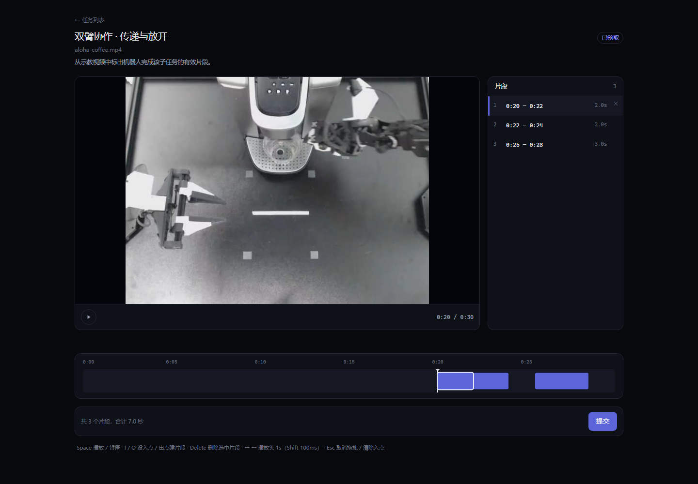

# 验收报告

## 结论

**能交付**，依据：`tsc` / `eslint` / `audit:rules` / `audit:sql` 全过，860 例单测全绿，
`scripts/e2e-check.mjs` 53 项全过，五组七条不变量在种子库与真实流程库上均 0 项违反。
M4 之后的加固（O1 认证、O2 重复实现与同源校验、O3 TOCTOU 与视频时长、O4 安全响应头）
与收尾七项（P1 标签保真、P2 并发守卫、P3 描边层级、P4 快捷键可关闭、P5 `aria-busy`、
P6 焦点管理、P7 太短提示）均已完成。
交互层**不再是「只能人眼验」**：两轮 Playwright 分别在真实 Chromium 里走了
一键进入 / 播放 / 撤销（19 项）与标签保真 / 延迟 DELETE 的并发守卫 / 相邻描边层级（20 项）。
但这两份脚本都不在 `npm test` 门禁里，仍是「跑过」而非「每次都会跑」——
交付验收时不能只看绿灯，证据与残余风险都写在文末。

## 交付范围

33 个功能点（A1–I3）+ 计划外 E8a + M4 之后的加固 O1–O4 + 收尾 P1–P7。

| 组 | 功能点 | 关键产出 |
|---|---|---|
| A 地基 | A1–A4 | 9 表 + 2 触发器、`createDb`/`writeTx`、种子、时区与区间工具 |
| B 认证 | B1–B4 | scrypt 密码、session 表、双套守卫、登录页 |
| C 视频 | C1–C2 | 流式上传、带鉴权的 Range 播放、管理页 |
| D 任务 | D1–D4 | 列表可见性、建任务、领取与归还、管理台 |
| E 工作台 | E1–E8 + E8a | 播放器、时间轴、拖拽、片段 CRUD、冲突提示、快捷键、撤销、只读回顾 |
| F 记账 | F1–F3 | 提交四写同事务、退回冲正、界面入口 |
| G 统计 | G1–G3 | 按天/按人/按任务聚合、CSV（带 BOM）、统计页 |
| H 审计 | H1–H2 | 审计写入（旁路/严格两种模式）、查询页 |
| I 验收 | I1–I3 | 五组不变量、检查器与变异验证、README 与报告 |
| O 加固 | O1–O4 | 认证加固、重复实现收口与同源校验、TOCTOU 与服务端时长、安全响应头 |
| P 收尾 | P1–P7 | 标签保真、并发删除守卫、描边层级、快捷键开关、删除态可读、焦点续接、太短提示 |

I 组本轮的结构性改动只有一处：种子数据从 `scripts/setup.mjs` 抽到 `scripts/seed.mjs`，
因为 `invariant-check.mjs --temp` 要灌同一份种子；复制两份必然漂移。

## 自动化验收

| 层 | 数量 | 结果 |
|---|---|---|
| 单元测试 | 860 例（44 文件） | 全绿 |
| 全链路 | 53 项（真实 HTTP） | 全过 |
| 不变量 | 五组 / 7 条规则 | 0 违反 |
| 静态检查 | `audit:rules`（6 条）/ `audit:sql` / `eslint .` / `tsc --noEmit` | 全过 |

用例数的演进：707（G/H 完成）→ 726（I1）→ 731（I1 补 5 例）→ 782（O1）
→ 797（O2）→ 828（O3）→ 832（种子演示口令 4 例）→ 850（P1 标签保真 18 例）
→ 853（O4 安全头 3 例）→ 860（P4–P7 无障碍 7 例）。

不变量的实际执行记录：

```
[invariant] 检查 18 个任务、15 条账目、14 条快照
[invariant] 0 项违反
```

两条路径（`data/app.db` 与 `--temp` 内存库）都跑过。`--temp` 的链路是
建任务 → 领取 → 标注 2 段 → 提交 → 退回 → 重新打开 → 再提交；
真实库那一次是在 `e2e-check.mjs` 跑完之后跑的，所以验的是「被验收脚本改过的库」。

最终回到干净种子库又跑了一次：`17 个任务 / 12 条账目 / 12 条快照`，0 项违反；
旧检查器 `db:check` 10/10。

## 变异验证汇总

「测试真的在测东西」只能靠改坏它来证明。以下每次变异后都恢复了原状并重跑全绿确认。

**检查器整体（I2 要求的三条）**

| 改坏了什么 | 变红 |
|---|---|
| `findViolations` 直接 `return []` | 16 例里 11 例红：全部「直插脏数据」用例 + `assertInvariants` 抛错用例 |
| 把汇总里的 `ledger-non-negative` 去掉 | 1 例红：「净额为负时报 ledger-non-negative…」，其余 15 例绿 |
| 所有 `subject` 改成 `''` | 8 例红：所有断言 subject 或消息前缀的用例 |

第二条是关键：只红一条，说明每条规则各自独立生效，不是「有一条能报就行」。

**逐规则（RULES 要求每条核心规则至少一次）**

| 去掉的规则 | 变红的用例 |
|---|---|
| `ledger-sum` | 1：账本是同一份提交的两倍时报 ledger-sum |
| `ledger-non-negative` | 1：净额为负时… |
| `snapshot-unique` | 1：同一任务有两条未被取代的快照… |
| `ledger-snapshot-match` | 3：日期不一致 / 金额不一致 / 冲正指向不存在的快照 |
| `status-claimed-pair` | 1：submitted 却没有领取人… |
| `tenant-consistency` | 4：片段 / 快照 / 账目三处租户不一致 + assertInvariants 消息 |

**脚本接线（I2 第二处接入）**

| 改坏了什么 | 变红 |
|---|---|
| 脚本对脏库不再 exit 1 | `tests/invariant-script.test.ts` 的「脏库上退出码为 1 并点名规则」 |
| 脚本对干净库仍 exit 1（恒抛） | 同文件的「干净库上退出码为 0」 |

A1–H2 的变异由各功能点在当轮执行，未留下统一台账；本表只记录本轮实际跑过的。
这是报告能给的下限，也是「变异验证覆盖不完整」这条风险的具体形态。

## M4 之后的加固

| 功能点 | 做了什么 | 变异验证（改坏一处语义 → 应红的用例） |
|---|---|---|
| O1 | 演示口令收进环境开关、补改密接口、`scrypt` 异步化、登录失败计数 | 漏 `await` → 两处各 4 例红；默认构建里 4 个 needle 全干净（正向对照：`DEMO_LOGIN=1` 构建命中） |
| O2 | 归属门禁 / 上传上限 / `newId` 收口，写接口补同源校验 | 删掉 claim 路由的校验调用，12 个函数级用例一条不红 → 改成 `audit-rules` 第 6 条（AST 扫描全部写 handler）才覆盖得住 |
| O3 | 提交读取挪进事务、服务端解析 mp4 时长、补 `snapshot-total` 不变量 | 片段列表挪回事务外 → TOCTOU 3 例全红；摘掉 `snapshot-total` 接线 → 2 例红；落库改回声明值 → 恰好 1 例红；把 `mdat` 当容器解析 → 5 例红 |
| O4 | 全站安全响应头（DENY / frame-ancestors / nosniff / same-origin） | 把 `source` 改成只覆盖 `/admin` → 恰好 1 例红 |

**加固过程中修掉的真实缺陷**（都属于「改了 A 没改 B」，且原有用例全绿）：

1. **演示 admin 的「一键进入」必然 401**。O1 把 seed 里 admin 的口令并成 `demo123`，
   登录页 `DEMO_ACCOUNTS` 仍发 `admin123`。没有任何用例读种子的口令，828 例全绿。
   补 `tests/seed-demo.test.ts` 4 例，两端各钉一次：把 seed 改回旧行为 → 2 例红；
   把登录页那张表的 admin 口令改掉 → 恰好 1 例红。
2. **默认模式一点播放就 404**。O1 的取舍是「数据全量、只随机口令」，任务始终插入并引用视频，
   但 `setup.mjs` 仍只在 `DEMO_LOGIN=1` 时复制素材。改成素材始终复制。
3. **Vitest 在 Windows 上的双实例**。cwd 盘符大小写不同（`d:` vs `D:`）会让 `vitest`
   被 Node 当成两个模块，worker 侧拿不到 runner。配置里按 `__dirname` 固定项目内入口。

---

## 收尾 P1–P3

这三条原先挂在 INDEX 的「未修」表里：都不影响主流程，但一个会丢数据、一个只靠人工、一个盖住反馈。

| 功能点 | 做了什么 | 变异 / 验证 |
|---|---|---|
| P1 标签保真 | 历史栈改存 `{startMs, endMs, label}`（匹配仍只比两端）；替换未传 label 继承旧值、显式 `null` 清空；撤销载荷 label 必填（漏传编译失败）；API 接受可选 label，长度与空串在 service 归一 | 服务丢 label → 7 例红；快照丢 label → 2 例红；载荷丢 label → 1 例红。浏览器：拖动后「有效操作」仍在；删除 → `Ctrl+Z` 后仍在 |
| P2 并发删除守卫 | 守卫逻辑原本就在（`deletingIdRef` 入口读 + 提示），这轮把它变成可重复复现：Playwright 拦截 DELETE 延迟 2 秒，在途窗口内拖空白处 | 浏览器：POST 0 次、DELETE 1 次、出现「正在删除片段，请稍候再试」；删除完成后重试 → POST 1 次（证明不是「拖拽坏了」） |
| P3 相邻描边 | 选中/冲突块 `z-10`、草案 `z-20` | 浏览器断言选中块 `z-index = 10`、兄弟 `auto`；目视截图见下 |

为什么标签要进历史栈而不是只在替换时继承：只继承能修拖动，修不了「删除后撤销」——
那时被替换项已经不存在，没有东西可继承。标签必须由历史自己带回来。

### P4–P7 无障碍收尾

| 功能点 | 做了什么 | 验证 |
|---|---|---|
| P4 快捷键可关闭（A3） | 页脚 checkbox，偏好存 `localStorage`；只停空格 / I / O，Delete / 方向键 / Ctrl+Z 不受影响；关闭时页脚改提示语，不教用户按已禁用的键 | 5 例纯函数；浏览器：关闭后空格不播放、I/O 不创建，刷新后仍关闭，重开可播放 |
| P5 `aria-busy`（G4） | 删除中按钮加 `aria-busy`，`aria-label` 改「第 N 段删除中」；同时在 aria-live 状态行播报「正在删除片段…」—— 按钮 `disabled` 会失焦，只挂 aria-busy 读屏器读不到 | 浏览器：延迟 DELETE 时读到 `aria-busy="true"`、「删除中」label 与状态行播报 |
| P6 焦点管理（G5） | 删除成功后：下一段 → 上一段 → 空态文本（`tabIndex=-1`）；竞态找不到目标时退回列表容器；撤销不触发 | 浏览器：删中间一段焦点落到下一段，删空后焦点在空态文本 |
| P7 太短提示（M6） | `onTooShort` 在状态行给中性色提示「至少 0.1 秒，入点还在」；写成功 / 删除 / 撤销 / Esc 清掉 | 2 例文案；浏览器：50ms 按 O 出现提示且无 POST，挪到 2.5s 再按成功 |

`TOO_SHORT_HINT` 的「0.1 秒」不是手写：直接取 `MIN_SEGMENT_MS / 1000`。
这条与之前 `MIN_SEGMENT_MS` 文档/代码差一倍的教训是同一类 —— 用户可见的数字必须从唯一定义处来。

---

## 浏览器层验收（三轮一次性 Playwright 脚本）

最初这节写的是「自动化代理没有图形浏览器」，撤销方向、拖拽创建、演示入口都只能靠人眼。
第一轮用 Playwright + Chromium 把能自动的部分补上了，19/19：

| 验什么 | 结果 |
|---|---|
| 登录页「演示账号」区渲染 | 出现（admin 入口 1 个） |
| 点「平台管理员」→ `/admin` | 通过（O1 引入的口令漂移已修，不再是 401 留在登录页） |
| 点「林小雨」→ `/tasks` | 通过 |
| 工作台 `<video>` 与 `/stream` | `206 Partial Content`，浏览器读到 `duration = 30` |
| 拖拽创建片段 | `POST 200`，列表 1 → 2 |
| `Ctrl+Z` 撤销创建 | `DELETE 200`，列表回到 1，区间与原来一致 |
| `Delete` 删除 + `Ctrl+Z` | `DELETE 200` → `POST 200`，区间恢复 |

**第一轮发现的真实问题**：撤销删除后时间对、`label` 没了。当时记入 INDEX 未修项，
本轮作为 P1 修掉并复验（拖动与撤销后「有效操作」都在）。

第二轮针对 P1–P3，20/20：

| 验什么 | 结果 |
|---|---|
| 拖动已存在的片段 | `POST 200`，行内与库里的 `label` 都还是「有效操作」 |
| 删除带标签的片段 → `Ctrl+Z` | `POST 200`，列表重新出现「有效操作」 |
| 删除在途（DELETE 延迟 2s）时拖空白处 | `POST 0` 次、`DELETE 1` 次，界面提示「正在删除片段，请稍候再试」 |
| 同一个手势在删除完成后重试 | `POST 1` 次，列表 1 → 2（排除「拖拽本身坏了」） |
| 相邻两段选中前一段 | 选中块 `z-index = 10`、兄弟 `auto`；四边描边完整 |



第三轮针对 P4–P7，21/21：

| 验什么 | 结果 |
|---|---|
| 页脚快捷键开关默认开启 | 通过 |
| 关闭后空格不播放、I/O 不创建 | 通过（POST 0 次） |
| 刷新后仍是关闭 | 通过（localStorage） |
| 重新开启后空格能播放 | 通过（`paused=false`） |
| 删除在途 `aria-busy` / label | `true` / 「第 2 段删除中」 |
| 删除在途状态行 | 播报「正在删除片段…」 |
| 删中间一段后的焦点 | 落在下一段的选中按钮（文本与预期区间一致） |
| 删空后的焦点 | 空态 `<p tabindex="-1">`，文本含「还没有片段」 |
| 50ms 按 O | 出现「太短…入点还在」，POST 0 次；挪到 2.5s 再按成功，提示消失 |

脚本是一次性的（`.workbuddy/browser-check.py`、`browser-polish.py`、`browser-a11y.py`，不进仓库），
所以它们证明「这一版能跑」，不证明「以后每次都能跑」。要变成门禁得接成 `npm test` 之外的一条独立 job。

---

## 人工验收清单

本轮由自动化代理执行；第 1–3 条已由上一节的两轮 Playwright 脚本走过，第 4 条只走了功能路径，
统计页的视觉没人看过。接口层的验证走的是 `npm run build && npm start`。

| # | 验什么 | 怎么做 | 应看到 | 本轮状态 |
|---|---|---|---|---|
| 1 | 撤销方向（H1） | 工作台拖出一段 → `Ctrl+Z` | 片段回到原位；停在原地或退回两步前都说明调用点传错了 before/after | **已执行**（创建与删除两条路径都回到原区间） |
| 2 | 并发删除守卫（O1c） | 删除在途时再拖另一段 | DELETE 恰好 1 次、POST 0 次，并出现「正在删除片段」 | **已执行**（路由拦截把 DELETE 延迟 2 秒，单指针复现；完成后重试 POST 1 次） |
| 3 | 相邻色块描边（H5） | 标两段首尾相接的片段并选中其中一段 | 选中描边不被后绘制的兄弟色块盖掉半圈 | **已执行**（选中块 `z-index=10`、兄弟 `auto`；截图四边完整） |
| 4 | 演示路径与视觉 | alice 领取 → 标注 → 提交 → admin 退回 → 统计页 | 当日净额回落、前一日的汇总不变；退回原因显示在工作台顶部 | 部分执行（一键进入、播放、拖拽与撤销已跑；统计页视觉未看） |

## 未修项

见 [`docs/steps/00-INDEX.md`](steps/00-INDEX.md) 的「未修的已知项」表，本文不重复抄。
表里原有的人工项（O1c / H5）与产品向条目（A3 / G4 / G5 / M6）已由 P2–P7 全部收口，
现在没有待修项；唯一保留的是 H1 的工程性说明 —— 撤销方向已用脚本验过，
但它不在 `npm test` 门禁里。

## 已知风险

1. **撤销方向仍不在门禁里（最高）。** 栈操作是纯函数、测得很扎实，但
   「Workbench 的调用点传的是 before 还是 after」在组件里。Reviewer 当年把它改成
   `record(segmentsRef.current)` 后 510 例全绿；如今 860 例同样一条也不会红。
   Playwright 实跑验证了方向是对的（创建与删除两条路径），但脚本不在 `npm test` 里，
   下次改 Workbench 不会自动发现回归。根治要引入组件测试（jsdom + Testing Library），
   或把浏览器脚本接成独立 job。
2. **交互层仍不在门禁里。** A3 / G4 / G5 / M6 这轮都补了，且用 Playwright 逐条验过；
   但项目没有组件测试设施，这些验证仍是一次性脚本，改组件不会自动变红。
   53 项全链路走的是 HTTP 与库。
3. **两套运行库检查器并存。** O2 已把重叠从 4 条降到 1 条：`db:check`（10 条，历史口径，
   配套 `db:verify-checker` 做变异验证）与 `invariant:check`（7 条，I1 契约口径）
   现在只有「快照唯一」一条是刻意保留的双写 —— 旧套能抓 `count=0`（提交了却没存档），
   新套也要抓，而 `verify-checker` 的既有变异正依赖旧套的输出。
   改这一条要同时改两处；其余规则各归各的，不再需要同步。
